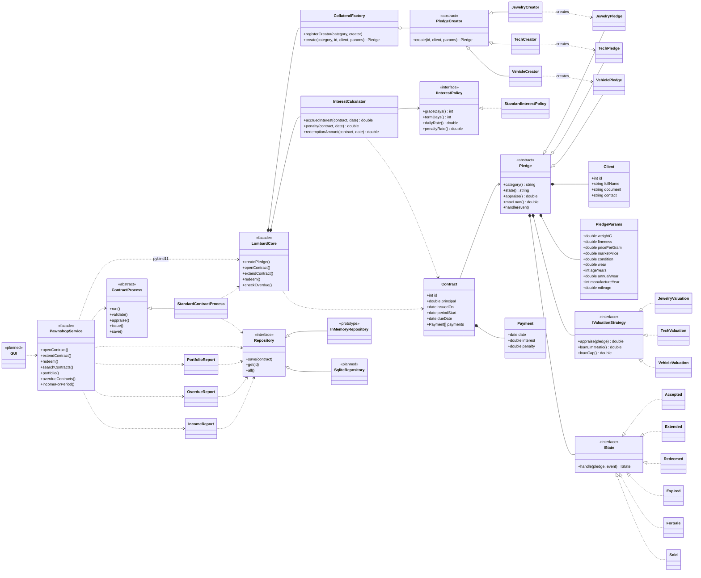
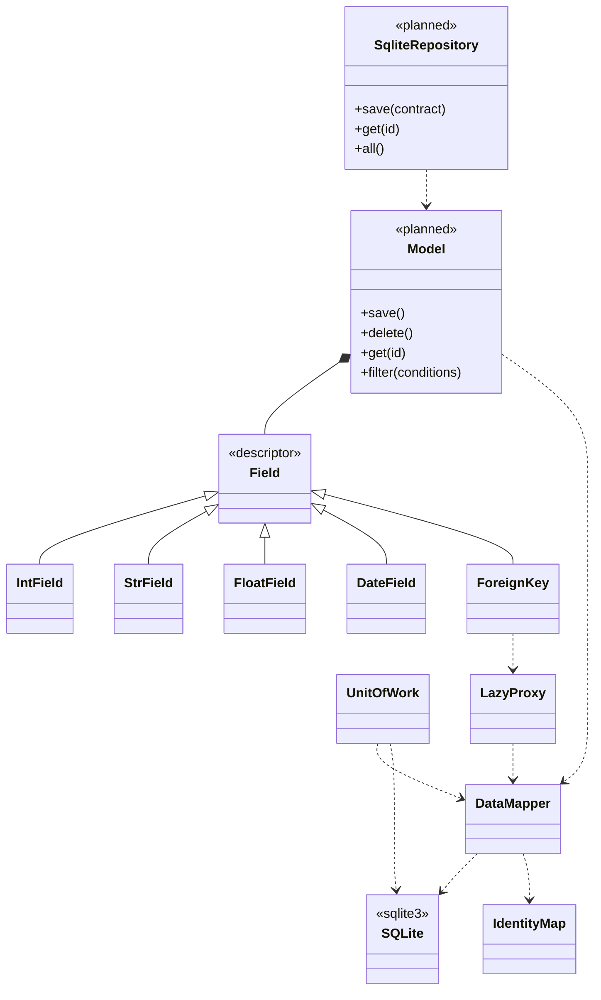

# Діаграми класів

Діаграми описують **цільову архітектуру** за [робочою копією SDD](SDD_lombard.md). Позначка «план» означає компонент, який ще не реалізовано. Дані між Python і C++ передаються через pybind11; `LombardCore` — фасад ядра, а `PawnshopService` — фасад для інтерфейсу.

## Предметна область і сценарії

## Запланований модуль зберігання minorm

Реалізовані класи та їхні відмінності від майбутніх компонентів описані у [README](../README.md). На схемі не показано кожен метод чи атрибут: деталі реалізації наведено у вихідних файлах.
