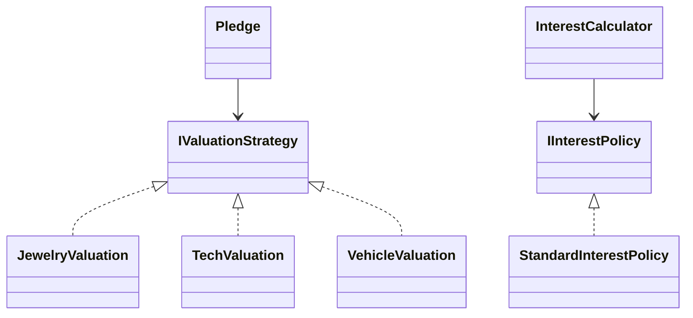
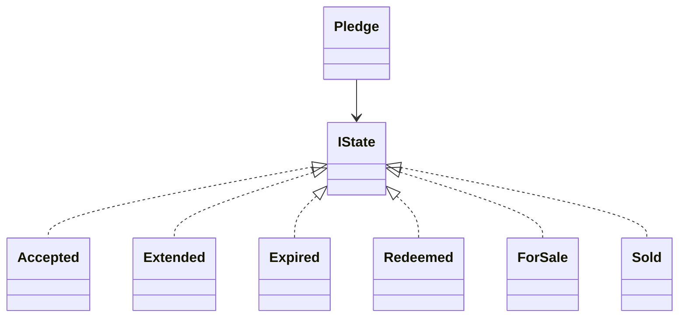
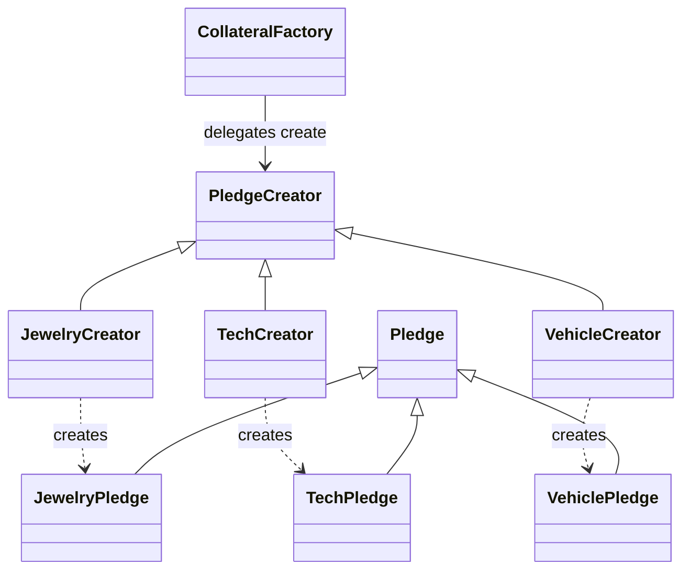
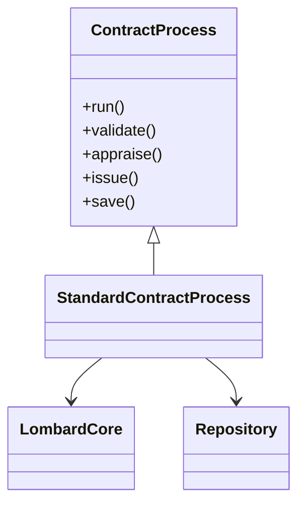
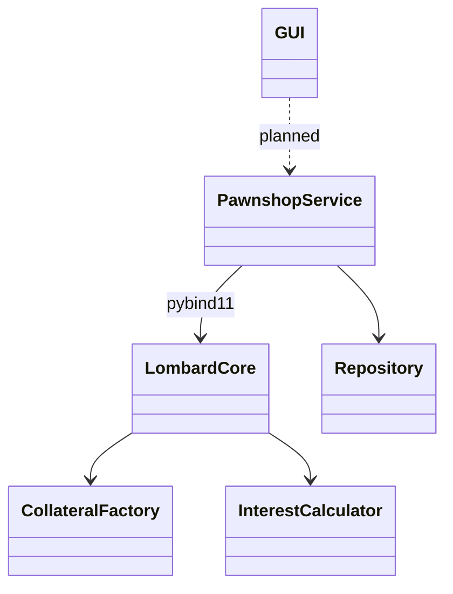

# Патерни проєктування

Документ обґрунтовує вибір п'яти патернів GoF із трьох груп, визначених у SDD. Файли C++ розташовані в `cpp_core`, Python — у `python_app`. Діаграми наведено у [class_diagram.md](class_diagram.md). Код зараз є навчальним прототипом; зберігання в SQLite, графічний інтерфейс і minorm заплановані на наступні етапи.

## 1. Strategy — поведінковий

**Задача.** Оцінка ювелірних виробів, техніки й транспорту залежить від різних вхідних параметрів; правила нарахування можуть змінюватися окремо від договору.

**Рішення.** `IValuationStrategy` задає інтерфейс оцінки, коефіцієнта та граничної суми; `JewelryValuation`, `TechValuation`, `VehicleValuation` реалізують правила. `Pledge::appraise()` і `maxLoan()` використовують його стратегію. `InterestCalculator` отримує `IInterestPolicy` через конструктор; поточний тариф — `StandardInterestPolicy`.

**Наслідок.** Формули та тариф ізольовані від сценаріїв. Нові реалізації можна додати окремими класами, але для нового виду застави також потрібні його клас, творець і реєстрація.

## 2. State — поведінковий

**Задача.** Дозволені операції залежать від етапу життя застави. Продана або викуплена застава не повинна повертатися до активного стану.

**Рішення.** `Pledge` делегує подію інтерфейсу `IState`. Класи `Accepted`, `Extended`, `Expired`, `ForSale`, `Redeemed`, `Sold` повертають наступний стан або породжують `InvalidTransitionError`. `Redeemed` і `Sold` — кінцеві. Правила переходів містяться у `cpp_core/src/pledge.cpp`.

**Наслідок.** Правила переходів сконцентровані у класах станів. Інтеграційний тест перевіряє всі пари станів і подій. Планувальник у майбутньому має викликати перевірку прострочення; наразі `checkOverdue(date)` викликається явно.

## 3. Factory Method — породжувальний

**Задача.** Категорія визначає конкретний тип застави і стратегію оцінювання, проте сценарій оформлення має працювати через спільний інтерфейс.

**Рішення.** Абстрактний `PledgeCreator` визначає метод `create`, а `JewelryCreator`, `TechCreator`, `VehicleCreator` перевизначають його і створюють відповідні підкласи `Pledge`. `CollateralFactory` — реєстр, який вибирає творця за рядком категорії та делегує створення. Сам реєстр є механізмом вибору; Factory Method реалізований ієрархією творців.

**Наслідок.** Створення певного виду застави інкапсульоване у відповідному творці. Для нового виду потрібні продукт, стратегія, творець і його реєстрація. Зараз стандартний реєстр налаштовується в конструкторі `CollateralFactory`; для відкритого розширення без редагування наявного коду слід на наступному етапі передавати налаштовану фабрику у `LombardCore` ззовні.

## 4. Template Method — поведінковий

**Задача.** Оформлення кожного договору потребує незмінного порядку дій: перевірка, оцінювання, видача та збереження. Деталі кроків можуть відрізнятися.

**Рішення.** `ContractProcess.run()` у `python_app/service.py` визначає послідовність і викликає абстрактні методи `validate`, `appraise`, `issue`, `save`. `StandardContractProcess` реалізує їх через `LombardCore` і `Repository`.

**Наслідок.** Послідовність доступна в одному місці, а реалізації кроків можна розширити в нащадку. У поточному прототипі репозиторій зберігає об'єкти лише в пам'яті; атомарність із базою забезпечуватиметься майбутнім Unit of Work.

## 5. Facade — структурний

**Задача.** Графічний інтерфейс не повинен знати про фабрику, стани та формули, а Python-код — про внутрішню структуру ядра C++.

**Рішення.** `PawnshopService` надає методи сценаріїв і звітів для майбутнього GUI. `LombardCore` надає операції ядра та експонується через pybind11 як `pawnshop_core.LombardCore`.

**Наслідок.** Залежність сценаріїв від внутрішніх класів ядра зменшується; виняток недопустимого переходу передається в Python. На етапі КТ2 запуск демонструється з консолі, а GUI ще не реалізовано.

## Інші шаблони в проєкті

`Repository` відокремлює сценарії від способу зберігання; він не належить до GoF. `InMemoryRepository` — тимчасова реалізація. У майбутньому модулі minorm заплановано Data Mapper, Identity Map і Unit of Work (патерни Фаулера), а також Proxy для лінивого завантаження. Їхній опис у SDD є проєктним рішенням, а не твердженням про готовий код. Singleton не використовується.
